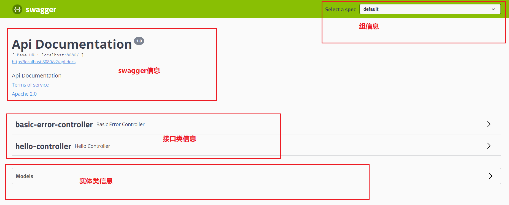
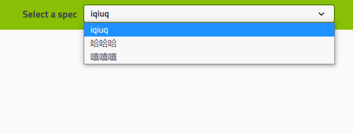
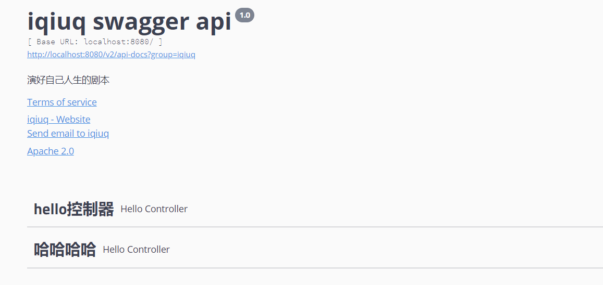
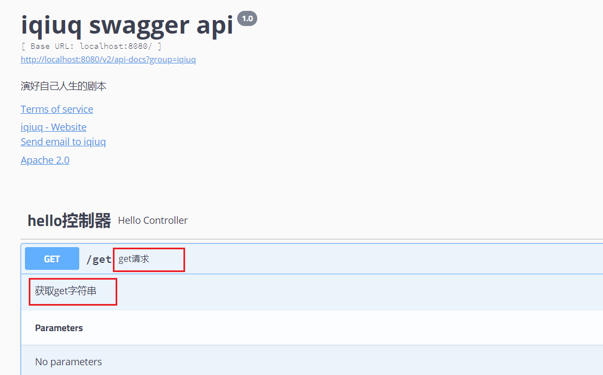
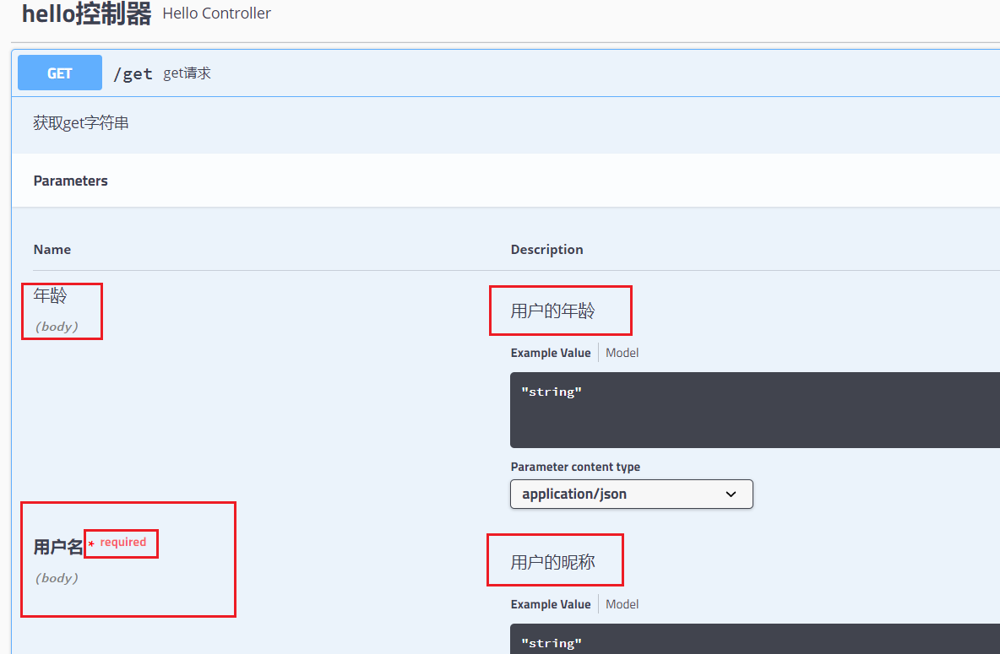
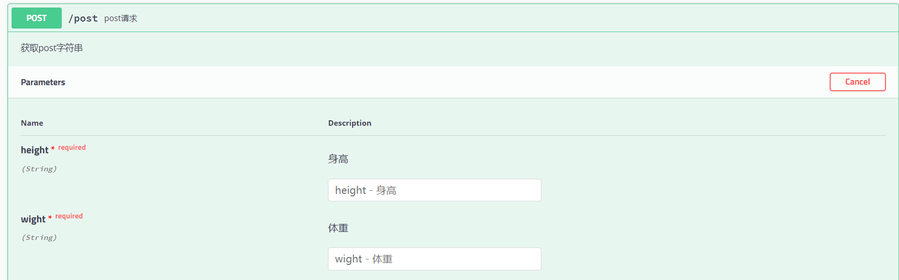
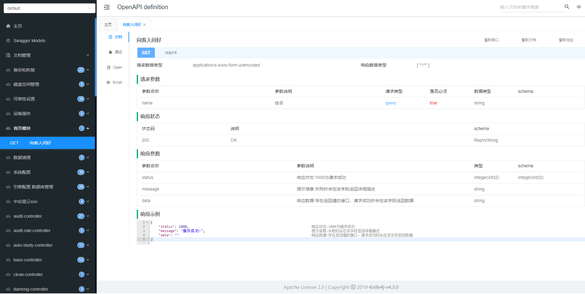

# Swagger入门

## 一、概述

目前，大多数系统都采用前后端分离。在享受前后端分离的好处的同时，接口联调往往成为团队效率的瓶颈，甚至产生前后端的矛盾。简单归结来说，有几方面的原因：

- 问题一，**接口设计滞后。** 后端团队往往不喜欢 API 接口设计先行，提前和前端沟通好接口。而在开发阶段的中后期，在后端提供 API 接口后，而这些接口和前端的预期有一些偏差，很容易就产生抱怨，特别是项目周期比较紧张的情况下。
- 问题二，**接口不规范。** 当团队里没有同意明确的接口规范时，又或者代码 Review 做的不是很好的情况下，千奇百怪、各式各样的 API 接口可能就产生了。前端在对接这样的 API 接口，苦不堪言，在一口 mmp 一嘴 fuck xxx 之中，调完接口。
- 问题三，**接口文档更新不及时，或者遗忘更新。** 因为后端 API 代码和 API 接口在两个地方，我们无法保证提交 API 代码的同时，及时更新文档。有的时候，我们甚至会遗忘更新 API 接口。随着时间的流逝，API 文档和 API 接口不一致的地方越来越多，前端会对 API 接口的信任度越来越低，然后不知道不觉之中，回到原始时代，直接问后端开发 API 是什么样的。

对于**问题一**和**问题二**，更多是开发流程上的问题，所以不在本文的范围内。当然话痨的艿艿，还是要给点粗浅的建议，完全拦不住我啊。

- **接口设计先行**。设计完成后，后端和前端进行简单沟通，看看是否能够满足诉求。
- **统一的接口规范**。一定要制定统一的接口规范文档，即使比较简陋，也能保证团队的 API 接口相对统一一致。即使错，咱也错的一模一样，而不是千奇百怪。当然，接口规范是无法覆盖到所有的场景的，借助于“接口设计先行”，我们可以提前去 Review 每个接口的设计。

对于**问题三**，就进入了本文的**主角 Swagger** 。通过在 API 接口上，添加相应的 Swagger 提供的注解，自动生成 API 文档。酱紫，API 接口和文档就在一起了，从此过上了幸福快乐的生活。

### 1.1 什么是Swagger

*REST APIs文档生成工具*。Swagger 是一个规范和完整的框架，用于**生成、描述、调用和可视化 RESTful 风格的 Web 服务**。

swagger主要包含了以下三个部分：

- swagger editor：基于浏览器的编辑器，我们可以使用它编写我们OpenApi规范(yaml或者json配置）
- Swagger UI：他会将我们编写的OpenApi规范呈现为交互式的API文档，后文我将使用浏览器来查看并且操作我们的RestApi
- Swagger Codegen：它可以通过OpenApi规范定义的任何API生成服务器存根和客户端SDK来简化构建过程

使用swagger就是把相关信息存储在它定义的描述文件里面（yml或json格式），再通过维护这个描述文件可以去更新接口文档，以及生成各端代码

**OpenAPI：** OpenApi与语言无关，只是一种规范，可以使用yaml和json格式进行编写，这样更利于我们和机器进行阅读

### 1.2 什么是Springfox

使用swagger时如果碰见版本更新迭代时，只需要更改swagger的描述文件即可，但是在频繁的更新项目版本时很多开发人员认为即使修改描述文件（yml或json文件）也是一定的工作负担，久而久之就直接修改代码，而不去修改描述文件了，这样基于描述文件生成接口文档也失去了意义。

- Marty Pitt编写了一个基于spring的组件`swagger-springmvc`，Spring-fox就是根据这个组件发展而来的全新项目;

- Spring-fox是根据代码生成接口文档，所以正常的进行更新项目版本，修改代码即可，而不需要跟随修改描述文件(yml或json文件);

- spring-fox利用自身AOP特性，把swagger集成进来，底层还是Swagger，但是使用起来却方便很多，所以在实际开发中，都是直接使用spring-fox。

## 二、swagger的使用

### 2.1 环境准备

1、新建spring boot项目

2、导入相关依赖

```xml
<!-- https://mvnrepository.com/artifact/io.springfox/springfox-swagger2 -->
<dependency>
    <groupId>io.springfox</groupId>
    <artifactId>springfox-swagger2</artifactId>
    <version>${springfox.vserion}</version>
</dependency>
 
<!-- https://mvnrepository.com/artifact/io.springfox/springfox-swagger-ui -->
<dependency>
    <groupId>io.springfox</groupId>
    <artifactId>springfox-swagger-ui</artifactId>
    <version>${springfox.vserion}</version>
</dependency>
```

3、启动类中添加`@EnableSwagger2`注解
`@enableSwagger2`：是springfox提供的一个注解，代表swagger2相关技术开启,会扫描当前类所在包，以及子包中所有的类型中的注解，做swagger文档的定值
4、编写一个简单api接口

```java
@RestController
public class HelloController {
    
    @GetMapping("/get")
    public String get() {
        return "get";
    }
    
    @PostMapping("/post")
    public String post() {
        return "post";
    }
    
    @RequestMapping("/hello")
    public String hello() {
        return "hello";
    }
}
```

5、启动项目，并在浏览器输入`http://localhost:8080/swagger-ui.html`进行swagger-ui界面访问



### 2.2 配置swagger

```java
@Configuration
@EnableSwagger2 //开启swagger2,若启动类上添加了该注解，则配置类可以不添加
public class SwaggerConfig {
 
    // 创建swagger bean
    @Bean
    public Docket docket(Environment environment) {
        // 配置swagger的docket的bean实例
        Profiles profiles = Profiles.of("dev","test");
        // 通过environment.acceptsProfiles()判断是否指定的环境中，是，则为true
        boolean flag = environment.acceptsProfiles(profiles);
        
        // Docket是swagger全局配置对象
        // DocumentationType：指定文档类型为swagger2
        return new Docket(DocumentationType.SWAGGER_2)
                // swagger信息
                .apiInfo(apiInfo())
                // 配置是否开启swagger，若为false，则浏览器不能访问
                .enable(flag)
                // swagger 扫描包配置
                // select()获取Docket中的选择器，返回ApiSelectorBuilder构造选择器，如扫描扫描包的注解
                .select()
                /**
                 * requestHandlerSelectors：请求处理选择器
                 * basePackage()：扫描指定包下的所有接口
                 * any()：扫描所有的包
                 * none()：不扫描
                 * withClassAnnotation()：扫描指定类上的注解，参数是一个注解的放射对象
                 * withMethodAnnotation()：扫描方法上的注解
                 */
                // 指定扫描器扫描的规则（断言）
                .apis(RequestHandlerSelectors.basePackage("com.demo.controller"))
                /**
                 * pathSelectors：路径选择器，过滤路径
                 * ang()：选择所有路径
                 * none()：都不选择
                 * ant()：选择指定路径
                 * regex()：正则表达式
                 */
                .paths(PathSelectors.regex("/hello"))
        		.build();
    }
 
    // 创建swagger bean
    @Bean
    public Docket docket1(Environment environment) {
        // 配置swagger的docket的bean实例
        Profiles profiles = Profiles.of("dev","test");
        // 通过environment.acceptsProfiles()判断是否指定的环境中，是，则为true
        boolean flag = environment.acceptsProfiles(profiles);
 
        return new Docket(DocumentationType.SWAGGER_2)
                // swagger信息
                .apiInfo(apiInfo())
                // 配置是否开启swagger，若为false，则浏览器不能访问
                .enable(flag)
                // 配置组名
                .groupName("iqiuq")
                .select()
                .apis(RequestHandlerSelectors.basePackage("com.demo.controller"))
                .paths(PathSelectors.regex("/hello"))
                .build();
    }
 
    @Bean
    public Docket docket2(Environment environment) {
        Profiles profiles = Profiles.of("dev","test");
        boolean flag = environment.acceptsProfiles(profiles);
 
        return new Docket(DocumentationType.SWAGGER_2)
                .apiInfo(apiInfo())
                .enable(flag)
                .groupName("哈哈哈")
                .select()
                .apis(RequestHandlerSelectors.basePackage("com.demo.controller"))
                .paths(PathSelectors.regex("/hello"))
                .build();
    }
 
    @Bean
    public Docket docket3(Environment environment) {
        Profiles profiles = Profiles.of("dev","test");
        boolean flag = environment.acceptsProfiles(profiles);
 
        return new Docket(DocumentationType.SWAGGER_2)
                .apiInfo(apiInfo())
                .enable(flag)
                .groupName("嘻嘻嘻")
                .select()
                .apis(RequestHandlerSelectors.basePackage("com.demo.controller"))
                .paths(PathSelectors.regex("/hello"))
                .build();
    }
    
    // swagger文档信息
    public ApiInfo apiInfo() {
        // 作者信息
        Contact contact = new Contact(
                // 文档发布者的名称
                "demo",
                // 文档发布者的网站地址
                "https://demo.com",
                // 文档发布者的电子邮箱
                "demo@mail.com"
        );
        return new ApiInfo(
                // 标题
                "demo api",
                // 文档描述
                "这是一个demo项目",
                // 版本号
                "1.0",
                // 服务组url地址
                "urn:tos", 
                // 作者信息
                contact,
                // 开源组织
                "Apache 2.0",
                // 开源地址
                "http://www.apache.org/licenses/LICENSE-2.0",
                // 集合
                new ArrayList()
        );
    }
}
```



## 三、swagger常用注解

swagger注解主要是用来给swagger生成的接口文档说明用的

### 3.1 @Api

- @Api：是类上注解，控制整个类生成接口信息的内容
  - tags：类的名称，可以有多个值，多个值表示多个副本，在UI视图中就显示几个控制器访问菜单
  - description：描述，已过时
    

### 3.2 @ApiOperation

- @ApiOperation：方法的说明，value值必须提供
  - value：说明方法的作用
  - notes：方法的备注说明
    

### 3.3 @ApiParam

- @ApiParam：可以作用于方法参数和成员变量
  - name：参数别名
  - value：参数的描述
  - required：是否必须需要
    

### 3.4 @ApiIgnore

- @Apilgnore：忽略，当前注解描述的方法或类型，不生成api文档

### 3.5 @ApiImplicitParam和@ApiImplicitParams

- @ApiImplicitParam：使用在方法上，描述方法的单个参数
  - name：参数名称
  - value：描述
  - required：是否必要参数
  - paramType：参数类型
  - dataType：数据类型
- @ApiImplicitParams：使用在方法上，描述方法的一组参数
  - value：是@ApiImplicitParam类型的数组
    

### 3.6 @ApiModel和@ApiModelProperty

- @ApiModel：描述一个实体类型，这个实体类型如果成为任何一个生成api帮助文档方法的一个返回值类型的时候，此注解被解析
  - value：自定义实体
  - description：详细描述
- @ApiModelProperty：实体类属性描述
  - name：字段别名
  - value：字段描述
  - required：是否是必须字段
  - example：示例数据
  - hidden：是否隐藏数据

### 3.7 @ApiResponse和@ApiResponses

@ApiResponses、@ApiResponse方法返回值的说明

- @ApiResponses：方法返回对象的说明
- @ApiResponse：每个参数的说明
  - code：数字，例如：300
  - message：信息，例如：”请求参数没填好"
  - response：抛出异常的类

### 3.8 其他注解

- @Authorization：声明要在资源或操作上使用的授权方案
- @AuthorizationScope：描述OAuth2授权范围
- @ResponseHeader：表示可以作为响应的一部分提供的标头
- @ApiProperty：描述POJO对象中的属性值
- @ApiError：接口错误所返回的信息

## 四、总结

1. 我们可以通过swagger给一些比较难理解的属性或接口，增加注释信息
2. 接口文档实时更新
3. 可以在线测试
4. 在正式发布的时候，关闭swagger，出于安全考虑，而且节省内存

## 五、Knife4j

第一步：[创建Spring Boot项目](https://spring.io/guides/gs/spring-boot/)并且在pom.xml中引入[Knife4j的依赖包](https://search.maven.org/search?q=g:com.github.xiaoymin)，代码如下：

```xml
<!--引入Knife4j的官方start包,该指南选择Spring Boot版本<3.0,开发者需要注意-->
<dependency>
    <groupId>com.github.xiaoymin</groupId>
    <artifactId>knife4j-openapi2-spring-boot-starter</artifactId>
    <version>4.3.0</version>
</dependency>
```

第二步：创建Swagger配置依赖，代码如下：：

```java
@Configuration
@EnableSwagger2WebMvc
public class Knife4jConfiguration {

    @Bean(value = "dockerBean")
    public Docket dockerBean() {
        //指定使用Swagger2规范
        Docket docket=new Docket(DocumentationType.SWAGGER_2)
                .apiInfo(new ApiInfoBuilder()
                //描述字段支持Markdown语法
                .description("# Knife4j RESTful APIs")
                .termsOfServiceUrl("https://doc.xiaominfo.com/")
                .contact("xiaoymin@foxmail.com")
                .version("1.0")
                .build())
                //分组名称
                .groupName("用户服务")
                .select()
                //这里指定Controller扫描包路径
                .apis(RequestHandlerSelectors.basePackage("com.github.xiaoymin.knife4j.controller"))
                .paths(PathSelectors.any())
                .build();
        return docket;
    }
}
```

第三步:新建一个接口Controller类，如下：

```java
@Api(tags = "首页模块")
@RestController
public class IndexController {

    @ApiImplicitParam(name = "name",value = "姓名",required = true)
    @ApiOperation(value = "向客人问好")
    @GetMapping("/sayHi")
    public ResponseEntity<String> sayHi(@RequestParam(value = "name")String name){
        return ResponseEntity.ok("Hi:"+name);
    }
}
```

万事俱备，启动Spring Boot项目，浏览器访问Knife4j的文档地址即可查看效果

```
http://localhost:8080/doc.html
```


